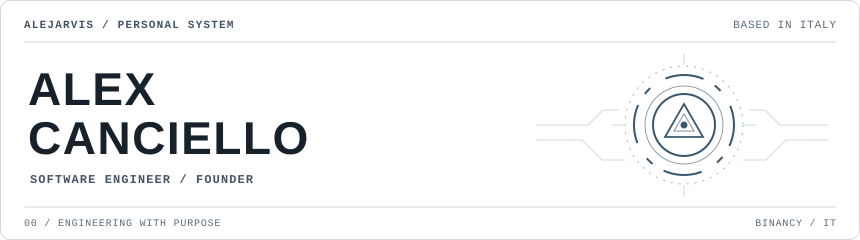
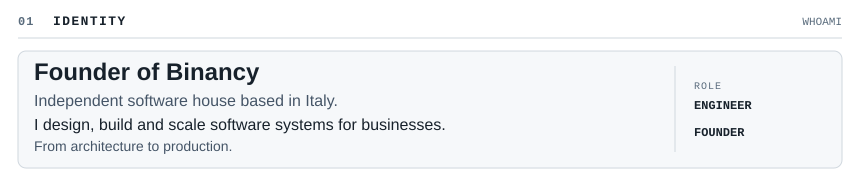
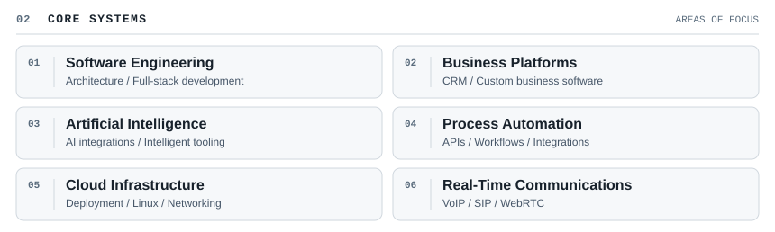
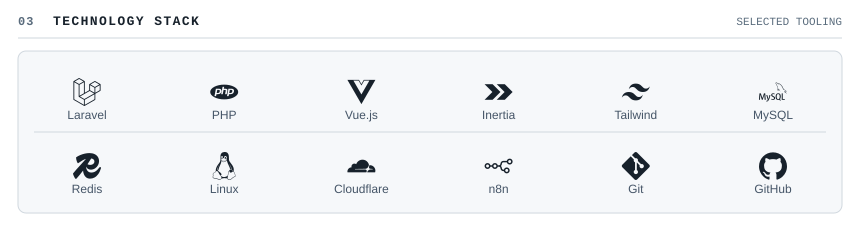
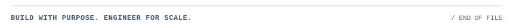

<picture>
  <source media="(prefers-color-scheme: dark)" srcset="assets/dark/header.svg">
  
</picture>

[Website](https://binancy.it) &nbsp;·&nbsp; [Email](mailto:alex@binancy.it)

<picture>
  <source media="(prefers-color-scheme: dark)" srcset="assets/dark/identity.svg">
  
</picture>

<picture>
  <source media="(prefers-color-scheme: dark)" srcset="assets/dark/systems.svg">
  
</picture>

<picture>
  <source media="(prefers-color-scheme: dark)" srcset="assets/dark/stack.svg">
  
</picture>

<picture>
  <source media="(prefers-color-scheme: dark)" srcset="assets/dark/footer.svg">
  
</picture>
